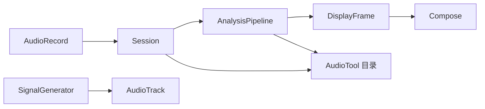

# 技术方案

## 架构

两个 Gradle 模块：

- `:core` 是纯 Kotlin JVM。FFT、计权、倍频程、发生器、RT60、校准和文件格式都在这里，并用 JUnit 验证。
- `:app` 是 `minSdk 26` 的 Jetpack Compose 应用，包名 `com.roomforge.droid`。它只负责麦克风、扬声器、手势和画面。

UI 通过 `Session` 的 `StateFlow` 读画面。采集线程只调用 `pipeline.push`，并用单独的 `LiveReadout` 发布帧耗时、极性和录音秒数，避免和主线程的设置写入互相覆盖。

## 技术选型

- Kotlin 2.0、Android Gradle Plugin 8.7、compileSdk 35、Build-Tools 35.0.0、Java 17 字节码
- 音频：`AudioRecord` / `AudioTrack`，16 bit。不使用 Oboe
- 界面：Compose Material 3，深色仪器配色。中文标签，麦克风和模式名称保留手册里的英文
- 持久化：`SharedPreferences` 存开关和校准；测量文件是文本或 PCM WAV

## 信号处理

- 基 2 FFT。Hann 窗的相干增益和功率增益按窗函数实际计算
- 倍频程按 Parseval 单边功率求和，再除以窗功率
- 全分辨率曲线按单频校准：落在 bin 中心的 Hann 正弦与时间域 SPL 对齐。显示时按对数最大抽到 480 个点
- A/C 使用 IEC 61672 模拟极点的双线性变换，并在 1 kHz 归一。X 曲线是 2048 点线性相位 FIR，幅度按 60 Hz 以下和 2 kHz 以上约 3 dB/oct 设计，重叠保留卷积
- 粉噪是 Paul Kellet 经济型 IIR。白噪是均匀随机数
- 极性模板是 1.5 ms 正半正弦，每 0.5 s 一次，用归一化相关检测，阈值 ±0.28
- RT60 的倍频程是 4 阶 Butterworth 高通加低通。Schroeder 从峰值向后积分；尾部仍在下降时不减噪声底
- 麦克风文件解析频率和 dB，跳过注释，识别 `Sens Factor` 和 `SERNO`。功率平均进 31 个 ISO 1/3 频带后相对 1 kHz，默认把响应取反

## 文件

目录是 `Android/data/com.roomforge.droid/files/AudioTool`，外部目录不可用时退到内部 `files/AudioTool`。

`.at` 的幅度列按手册公式反推，使校正 dB 能被原公式还原。倍频程块标题为 `1/3 Octave Data` 等形式，列是频率、dB、谷值、峰值。这是 Rex Beckett 的 REW 转换器要读的部分。

## 界面

主画面分三区：上方频谱，中间示波器和 SPL，下方按钮。模式、速度、计权、运行、平均、峰值和谷值的按钮文字就是当前状态。菜单覆盖分辨率、麦克风、刻度、光标、校准、目标、Sone、NC、NR、频谱图速度、瀑布图、Leq、屏幕和字体。发生器、RT60、31 段圆盘和文件管理是独立画面。

## 测试

`:core:test` 覆盖 FFT、ISO 频带、A/C/X、粉噪与白噪斜率、校准拉平、扫频与极性、Schroeder RT60、Leq、`.at` 公式、Dayton 文本、NC/NR 和 Sone。`:app:assembleDebug` 确认 Android 工程能打包。没有模拟器，不把仪器画面的手势当成已经在设备上点过。

## 安全与隐私

不需要账号，不联网，不上传测量。录音和频谱只留在应用私有目录，除非用户主动分享或导出。麦克风、蓝牙连接是运行时权限。
